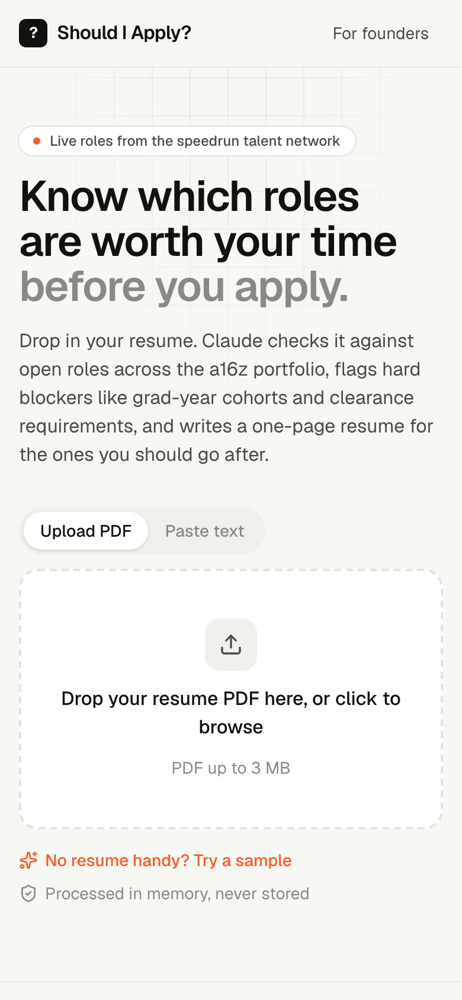
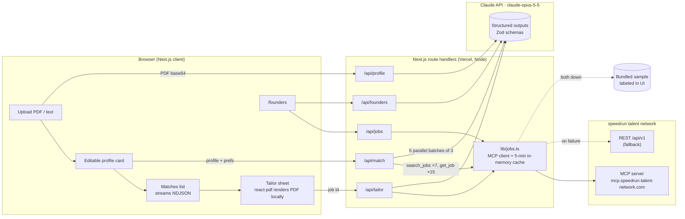

# Should I Apply?

**Job seekers waste hours on roles they were never eligible for, and still send the same generic resume to the ones they are.
Should I Apply? reads your resume, checks it against live roles from the a16z speedrun jobs board, and tells you Apply, Stretch or Skip, with reasons and a tailored one-page resume.**

**Live:** https://speedrun-should-i-apply.vercel.app  ·  **No resume handy?** Click "Try a sample" on the landing page.


<sub>Recorded with Playwright against the production deploy (`npm run record-demo`). Waiting on Claude is sped up about 10x; everything else is real time. The resume is synthetic.</sub>

## What it does

1. **Profile.** Upload a PDF (or paste text). Claude parses it into a structured profile: education, grad year, roles, skills, projects, links. You get an editable card, preference toggles (relocation, remote only, sponsorship) and an optional email field.
2. **Matches.** Pulls about 15 relevant live roles from speedrun's MCP server and has Claude score each one. Every role gets an **Apply / Stretch / Skip** verdict, a 0-100 fit score and 2-3 reasons that quote the posting *and* point to a resume fact. Hard blockers are called out in red: grad-year cohorts, years-of-experience floors, clearance or citizenship, sponsorship, on-site location, required degrees. Apply roles sort first, and you can filter by verdict, location and role type. Results stream in as each batch finishes.
3. **Tailor.** For any role, Claude writes a one-page resume using only facts from your profile. Any bullet that rewords beyond what you wrote is flagged with an explanation. You get a PDF preview with download (`@react-pdf/renderer`, generated in the browser) and draft answers to three common application questions.
4. **`/founders`.** The other side of the table: pick a live speedrun role and get a ranked shortlist of 7 **synthetic demo candidates** (clearly labeled), each with fit reasons and the main risk.

<p align="center"></p>

## Architecture



- **Key handling:** the Anthropic key lives only in server env (`ANTHROPIC_API_KEY`) and is used only from route handlers (`import "server-only"`). It is never sent to the browser.
- **No user data stored:** resumes and profiles live in React state and travel in request bodies. Nothing is written to a database, logged or cached server-side. The only server cache holds public job listings.
- **Model:** `claude-opus-5-5` with adaptive thinking. Effort is `low` for parsing, scoring and founder shortlists and `medium` for tailoring. Every call uses structured outputs (`messages.parse` + Zod), so the UI never parses free text. Server-side refusal fallbacks are on.
- **Speed:** jobs are pulled and shown in about a second. Scoring runs as 5 parallel batches of 3 roles, and verdicts stream to the client as NDJSON. A full run takes about 15-20s for 15 roles.

## Data source

**MCP status.** speedrun publishes a public, no-auth **MCP server** at `https://mcp.speedrun-talent-network.com/mcp` (streamable HTTP), documented at [speedrun-talent-network.com/developers](https://speedrun-talent-network.com/developers), plus a matching REST API at `/api/v1` with an OpenAPI spec. (`speedrun.a16z.com` itself has no developer endpoints; they all live on the talent network domain.)

**How jobs are pulled** ([`src/lib/jobs.ts`](src/lib/jobs.ts)):

1. **Primary:** the app's server is an MCP client (`@modelcontextprotocol/sdk`). It calls `search_jobs` with the profile's Claude-generated queries and target functions, once scoped to the speedrun portfolio and once to the full a16z portfolio. Then it calls `get_job` for full descriptions.
2. **Fallback:** the same queries over the REST API (`/api/v1/jobs`, `/api/v1/jobs/{id}`) if the MCP call fails.
3. **Last resort:** a small bundled set of fictional roles, shown with a **"Sample data"** badge so it's never mistaken for live listings.

Results are cached in memory for 5 minutes. Calls pass `source=should-i-apply` as the docs ask, links go to the canonical posting on speedrun-talent-network.com, and stealth companies are excluded. The app reads public listings only. It never calls `join_network` or `express_interest`.

## Why I built this

I spent months as a job seeker doing this exact workflow by hand (fit checks, cohort filters, tailored one-page resumes), and this is the tool I wished existed.

## What I'd build next for speedrun

**A candidate agent that talks to founder agents, Jack & Jill style.** The structured profile and per-role fit data this app produces are exactly what an agent needs to represent a candidate:

- The candidate agent holds the profile, preferences and hard constraints (location, sponsorship, start date, comp floor). It watches new roles through the speedrun MCP server and pre-screens them with the same Apply / Stretch / Skip engine.
- For Apply-tier roles it opens a conversation with the founder's agent: it shares the cited fit reasons, answers screening questions from the profile, and negotiates logistics. It escalates to the human only when both sides clear a bar.
- The founder agent uses the `/founders` ranking, run on real opted-in candidates instead of synthetic ones, so each side sees *why* the other is a fit before anyone books a call.
- It plugs into speedrun's existing consent-first `join_network` / `express_interest` tools, so warm intros stay with the talent team.

## Run it locally

```bash
cp .env.example .env.local   # add ANTHROPIC_API_KEY (https://platform.claude.com/settings/keys)
npm install
npm run dev
```

Stack: Next.js 16 (App Router), TypeScript, Tailwind CSS v4, Motion, `@anthropic-ai/sdk`, `@modelcontextprotocol/sdk`, `@react-pdf/renderer`, Zod.

`docs/sample-resume.pdf` is the synthetic resume (a fictional person) used for testing and the demo.

---

<sub>Built by Vikaas Venkatesh as an application for the a16z speedrun Product Engineer role. Not affiliated with or endorsed by a16z.</sub>
